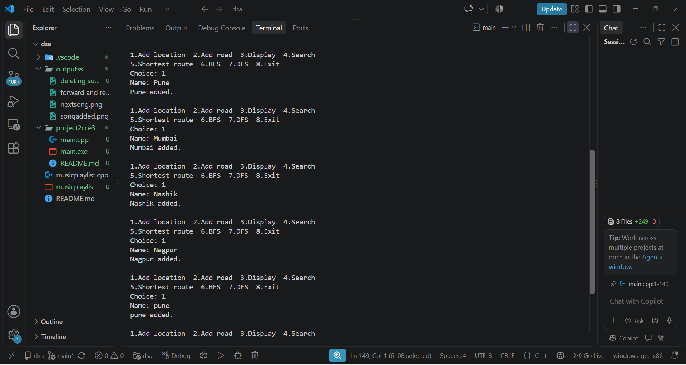

# Shortest Path Finder and Road Network Navigation System (C++)

Course: Data Structures and Algorithms, CCE III Course Project, Semester III (Oct 2026)
Student:[Tambe Aditi Santosh], S.Y. B.Tech Electronics and Computer Engineering
College: Amrutvahini College of Engineering, Sangamner

## About
A menu-driven C++ program that stores a road network as a graph and finds the shortest route between two locations. Everything is built manually. No STL containers (vector, list, stack, queue, map, set) are used.

## Graph Details
- Vertices are locations and edges are roads.
- The graph is weighted (distance in km) and **undirected** (every road is two-way).
- It is stored as an adjacency matrix: `road[a][b]` holds the distance, and `0` means no road.
- Limits: at most 10 locations, names up to 19 characters, distances from 1 to 10000 km.

## Features
| Menu option | What it does | Technique |
|---|---|---|
| 1. Add location | Adds a new place (rejects empty, duplicate, or when full) | Array insert |
| 2. Add road | Connects two places with a distance | Matrix update |
| 3. Display | Shows every place and its roads | Matrix scan |
| 4. Search | Checks whether a place exists | Linear search |
| 5. Shortest route | Prints the shortest distance and the actual route | Dijkstra |
| 6. BFS | Lists places reachable from a start place | BFS with array queue |
| 7. DFS | Traverses the network from a start place | Recursive DFS |
| 8. Exit | Ends the program | |

## OOP Concepts
A `Graph` class with private data and a constructor that sets up an empty network.

## How to Compile and Run
```
g++ -Wall -Wextra -o main main.cpp
./main
```

## Example
Add Sangamner, Pune, Nashik and Mumbai. Add roads Sangamner-Pune 120, Sangamner-Nashik 85, Pune-Mumbai 150 and Nashik-Mumbai 165. Then the shortest route from Sangamner to Mumbai is:
```
Shortest distance: 250 km
Route: Sangamner -> Nashik -> Mumbai
```

## Screenshots
| | |
|---|---|
| Location added |  |
| Road added |  |
| Shortest distance |  |
| BFS and DFS |  |
| Edge cases |  |

## Limitations
- Data is lost when the program closes (no file saving).
- Roads and locations cannot be deleted.
- Names are case-sensitive, and the network is limited to 10 locations.
- Only distance is considered (no traffic or travel time).

## Future Scope
Saving and loading the network from a file, deleting roads, using an adjacency list for larger networks, and a priority-queue-based Dijkstra.